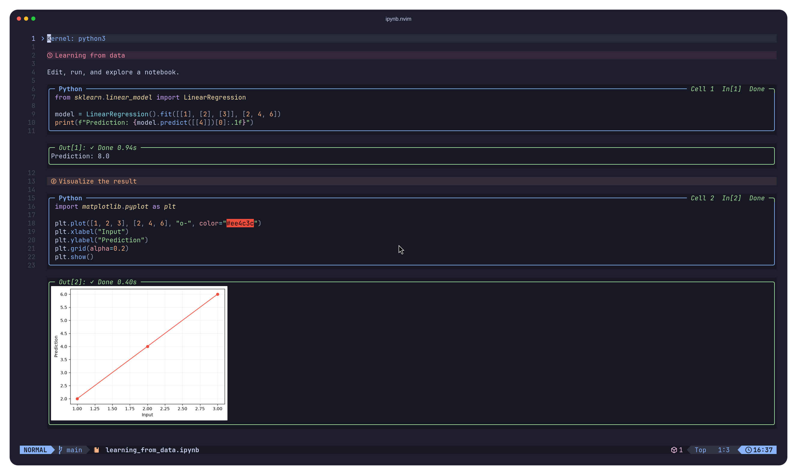

<p align="center"></p>

<h1 align="center">ipynb.nvim</h1>

<p align="center"><a href="https://jupyter.org/">Jupyter</a> notebooks in <a href="https://neovim.io">Neovim</a>. Edit cells, run code, and view plots in your terminal.</p>

<p align="center">
  <a href="https://github.com/WhiteHades/ipynb.nvim/releases/latest"></a>
  <a href="https://neovim.io"></a>
  <a href="LICENSE"></a>
  <a href="https://jupyter.org/"></a>
</p>

<p align="center"><a href="assets/notebook.png"></a></p>

## Install

Requires Neovim 0.12 or newer. Add this plugin spec to your [lazy.nvim](https://github.com/folke/lazy.nvim) configuration:

```lua
return {
  "WhiteHades/ipynb.nvim",
  lazy = false,
  opts = {},
}
```

Run `:Lazy sync`, then `:IpynbInstall` and restart Neovim.
See [installation details](doc/install.md) for system requirements and image setup.

## Use

Open `nvim example.ipynb`. Keys use Normal mode unless noted; `<localleader>` defaults to `\`.

| Keys | Action |
| --- | --- |
| `<localleader>n` or `:Ipynb` | Open notebook actions. |
| `<localleader>r` or `Ctrl+Enter` | Run cell. |
| `<localleader>r` in Visual mode | Run selection. |
| `Shift+Enter` | Run cell and move to the next code cell. |
| `<localleader>R` | Run all cells. |
| `<localleader>a` | Run cell and cells above. |
| `<localleader>b` | Add code cell below. |
| `<localleader>m` | Add Markdown cell below. |
| `<localleader>s` | Interrupt execution. |
| `<localleader>o` | Expand or collapse the current cell output. |
| `<localleader>O` | Close the expanded output. |
| `<localleader>x` | Open image or HTML output. |
| `<localleader>i` | Restart kernel and clear variables. |
| `j` / `k`, `Ctrl+D` / `Ctrl+U` in output view | Browse output. |
| `q` or `Esc` in output view | Return with full output anchored below its cell. |
| `<localleader>o` in output view | Collapse the current output. |
| `q` or `Esc` in image viewer | Close the image viewer. |
| `zo` / `zc` | Open / close metadata. |
| `i` | Edit cell and fences. |
| `:w` | Save with configured formatting and linting. |

Existing mappings take precedence. Modified Enter keys depend on your terminal.

See [configuration and saving](doc/ipynb.txt) for settings and standalone environments.

[PyTorch](https://github.com/pytorch/pytorch) can use CUDA in your project kernel; notebook code selects GPU or CPU.

## Help

Run `:checkhealth ipynb` to check setup or `:IpynbInstall` to repair it.
See [Jupytext](https://github.com/mwouts/jupytext), [format help](doc/jupytext.md), [testing](native/README.md), [credits](CREDITS.md), or [report an issue](https://github.com/WhiteHades/ipynb.nvim/issues).
